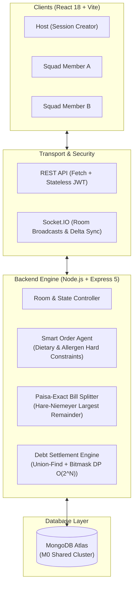

# 🍔 FoodSquad – Real-Time Collaborative Ordering & Debt Settlement Engine

[](https://reactjs.org/)
[](https://vitejs.dev/)
[](https://nodejs.org/)
[](https://expressjs.com/)
[](https://www.mongodb.com/)
[](https://socket.io/)
[](https://nodejs.org/api/test.html)
[](LICENSE)

> **Live Production Demo**: [food-squad.vercel.app](https://food-squad.vercel.app/)  
> **Backend API**: [food-squad-2.onrender.com](https://food-squad-2.onrender.com/)

**FoodSquad** is a high-concurrency, real-time collaborative food ordering and bill settlement platform. It eliminates post-meal financial friction by enabling squads to join shared ordering sessions via room codes, add cravings concurrently via WebSockets, filter menu items through an AI constraint-satisfaction agent, and settle debts using graph-theoretic cash-flow minimization.

---

## ⚡ Core Engineering Highlights

Unlike traditional CRUD food delivery apps, FoodSquad solves complex distributed state and combinatorial optimization problems:

### 1. NP-Hard Debt Simplification (Union-Find + Bitmask DP $O(2^N)$)
* **Problem**: In a group of $N$ friends ordering together over multiple meals, peer-to-peer debts form a dense directed graph with up to $O(N^2)$ transactions.
* **Solution** ([`settlement.js`](file:///server/src/services/settlement.js)):
  1. Computes net balances per individual.
  2. Applies **Union-Find (Disjoint-Set)** over active debt pairs to isolate connected components—guaranteeing strangers in unrelated friend circles are never asked to settle with one another.
  3. Solves minimum cash-flow minimization using an exact **Bitmask Dynamic Programming** algorithm for components with $\le 14$ participants (finding the maximum number of disjoint zero-sum subsets), reducing payments to the theoretical minimum of $V - k$ (where $k$ is the number of zero-sum partitions).
  4. Falls back to a deterministic greedy heuristic for large graphs.

### 2. Zero-Paise-Loss Currency Allocation (Largest Remainder Method)
* **Problem**: Standard IEEE-754 floating-point division causes rounding discrepancies where individual member bill shares fail to sum to the restaurant receipt total.
* **Solution** ([`split.js`](file:///server/src/services/split.js)):
  1. All internal monetary units are calculated and stored in integer **paise** (1 INR = 100 paise).
  2. Cart lines are split evenly across active eaters, with deterministic leftover distribution.
  3. Shared taxes, packaging, delivery fees, and discounts are proportionally allocated using the **Hare-Niemeyer Largest Remainder Method**.
  4. Verified by **property-based test suites** across 500+ randomized permutations to strictly guarantee:
     $$\sum \text{Member Shares} \equiv \text{Receipt Total}$$

### 3. Deterministic Constraint Satisfaction AI Order Agent
* **Problem**: Recommending group orders when squad members have overlapping dietary restrictions, allergies, and strict personal budgets.
* **Solution** ([`agent.js`](file:///server/src/services/agent.js)):
  1. **Hard Filtering**: Enforces strict dietary constraints (Veg, Vegan, Jain, Gluten-Free, Egg-Free, Nut Allergies, and custom dislikes) before any recommendation ranking occurs.
  2. **Soft Ranking**: Scores compliant candidate items against member mood heuristics (Spicy, Comfort Food, Light, High Protein, Sweet).
  3. **Knapsack Optimization**: Assembles a squad feast maximizing diversity while keeping every single participant strictly within their individual budget cap.

### 4. Real-Time Distributed Cart Synchronization
* Authoritative server-side state machine with **Socket.IO** rooms.
* Ephemeral room codes generated using collision-resistant crypto prefixes (e.g., `BBQ-4821`).
* Optimistic UI reconciliation ensures sub-100ms UI response times during concurrent cart edits.

---

## 🏗️ System Architecture



---

## 🛠️ Tech Stack

| Domain | Technology | Purpose |
|---|---|---|
| **Frontend** | React 18, Vite | High-performance SPA with client-side routing & fast HMR |
| **Styling & UI** | CSS Custom Properties, Lucide Icons | Fluid, responsive design system with dark/light visual hierarchy |
| **Real-Time** | Socket.IO Client / Server | Instantaneous room synchronization across concurrent participants |
| **Backend** | Node.js (>=20.19), Express 5 | Authoritative REST API, middleware security, async error handling |
| **Database** | MongoDB Atlas, Mongoose 9 | Document persistence for restaurants, menus, rooms, and ledgers |
| **Authentication**| Stateless JWT (`jsonwebtoken`) | Ephemeral guest sessions with room-scoped permissions |
| **Testing** | Node.js Native Test Runner (`node:test`) | Unit, property-based, and end-to-end integration tests |
| **Deployment** | Vercel (Frontend), Render (Backend) | Global edge CDN + persistent WebSocket container hosting |

---

## 📂 Project Structure

```text
Food-squad/
├── client/                      # React 18 + Vite Frontend
│   ├── public/                  # Static assets & restaurant SVG badges
│   ├── src/
│   │   ├── api.js               # API client, JWT management & room session sync
│   │   ├── socket.js            # Socket.IO client instance & event listeners
│   │   ├── App.jsx              # Main application views (Dashboard, Directory, Room, Cart, Settlement)
│   │   ├── LandingPage.jsx      # High-converting landing page with live preview
│   │   ├── styles.css           # Modern CSS variable design system
│   │   └── main.jsx             # React DOM root entry
│   └── vite.config.js           # Vite dev proxy configuration
│
├── server/                      # Node.js + Express 5 Backend
│   ├── src/
│   │   ├── controllers/         # HTTP request handlers (app.controller.js)
│   │   ├── middleware/          # JWT verification & CORS preflight handlers
│   │   ├── models/              # Mongoose schemas (Room, Restaurant, User, Debt, Payment)
│   │   ├── routes/              # Express API router (api.routes.js)
│   │   ├── seed/                # Partner restaurant seed data & upsert scripts
│   │   ├── services/
│   │   │   ├── agent.js         # Dietary hard-filtering & AI menu ranking
│   │   │   ├── split.js         # Exact-paisa & Hare-Niemeyer bill computation
│   │   │   ├── settlement.js    # Union-Find & Bitmask DP debt minimization
│   │   │   ├── room.service.js  # Room lifecycle & code allocation
│   │   │   └── state.service.js # Authoritative state snapshot compiler
│   │   ├── config.js            # Environment config & pricing rules
│   │   └── index.js             # HTTP & Socket.IO server bootstrap
│   └── tests/                   # 18 Unit & Property-Based Test Suites
│       ├── agent.test.js        # Allergen, vegan/Jain hard-block tests
│       ├── flow.test.js         # End-to-end order placement & ledger pipeline
│       ├── settlement.test.js   # DP debt simplification vs. brute-force verification
│       └── split.test.js        # 500-permutation zero-drift property test
│
└── README.md
```

---

## ⚙️ Installation & Local Setup

### Prerequisites
* **Node.js**: `v20.19.0` or higher
* **MongoDB**: A local instance or a free [MongoDB Atlas](https://cloud.mongodb.com/) cluster connection string

### 1. Clone the Repository
```bash
git clone https://github.com/MahakGupta390/Food-squad.git
cd Food-squad
```

### 2. Configure Environment Variables

#### Backend (`server/.env`):
Create a `.env` file in the `server` directory:
```env
PORT=4000
NODE_ENV=development
MONGO_URI=mongodb+srv://<username>:<password>@cluster.mongodb.net/foodsquad?retryWrites=true&w=majority
JWT_SECRET=your-super-secure-32-char-random-secret
CLIENT_URL=http://localhost:5173
```

#### Frontend (`client/.env` - Optional for local dev):
Locally, Vite proxies `/api` and `/socket.io` to `http://localhost:4000` automatically via `vite.config.js`. For production deployments, specify:
```env
VITE_API_URL=https://your-backend-service.onrender.com
```

### 3. Install All Dependencies
```bash
npm run install:all
```
*(Or install manually: `npm install && cd server && npm install && cd ../client && npm install`)*

### 4. Run Locally
Start both backend and frontend concurrently with a single command:
```bash
npm run dev
```

* **Frontend**: `http://localhost:5173`
* **Backend API**: `http://localhost:4000`
* **Health Check**: `http://localhost:4000/api/health`

---

## 🧪 Automated Testing

FoodSquad includes **18 comprehensive unit and property-based tests** written using the native Node.js test runner (`node:test` and `node:assert/strict`).

Run the test suite:
```bash
cd server
npm test
# or: node --test tests/*.test.js
```

### What the test suite validates:
* **`split.test.js`**: Property-based testing over 500 randomized bills guaranteeing individual member shares sum **exactly** to the total bill with zero floating-point remainder errors.
* **`settlement.test.js`**: Validates Union-Find component isolation and checks that the Bitmask DP minimization matches the brute-force optimal number of transactions on random connected graphs.
* **`agent.test.js`**: Confirms hard dietary isolation (veg members never receive non-veg, Jain/Vegan tags enforced, allergy and dislike keywords blocked) and budget boundaries.
* **`flow.test.js`**: Integration test driving the full controller state machine: Room creation $\rightarrow$ Cart mutation $\rightarrow$ Eater allocation $\rightarrow$ Order placement $\rightarrow$ Debt calculation $\rightarrow$ Settlement ledger.

---

## 📡 API & Socket.IO Reference

### REST Endpoints
| Method | Path | Auth Required | Description |
|---|---|:---:|---|
| `GET` | `/api/health` | No | Uptime & health check monitor |
| `POST` | `/api/session` | No | Creates ephemeral guest session and signs JWT token |
| `GET` | `/api/state` | Yes | Retrieves current user room state, cart, menu, and ledger |
| `POST` | `/api/restaurant/select` | Yes | Selects a partner restaurant and creates/updates room |
| `POST` | `/api/rooms/join` | Yes | Joins an existing squad room via share code |
| `POST` | `/api/prefs` | Yes | Updates participant budget, dietary tags, mood, and dislikes |
| `POST` | `/api/cart/add` | Yes | Adds a menu item to the collaborative squad cart |
| `POST` | `/api/cart/qty` | Yes | Updates line-item quantity in the room cart |
| `POST` | `/api/cart/eat` | Yes | Toggles whether a member is an eater for a specific line item |
| `GET` | `/api/agent` | Yes | Returns dietary-verified AI meal recommendations |
| `POST` | `/api/agent/accept` | Yes | Commits AI recommendations directly to group cart |
| `POST` | `/api/order/place` | Yes | Host authorization to finalize cart, calculate shares & record debts |
| `POST` | `/api/paid` | Yes | Confirms peer payment in the room settlement view |
| `POST` | `/api/ledger/settle` | Yes | Marks a debt transaction cleared on personal dashboard |

### WebSocket Events
* `join-room` *(Client $\rightarrow$ Server)*: Authenticates socket connection and binds user to the room channel.
* `room:update` *(Server $\rightarrow$ Client)*: Emitted upon any state delta (cart update, preference change, order placement) triggering instantaneous state reconciliation.

---

## 📜 License & Acknowledgments

Distributed under the **MIT License**. See `LICENSE` for more information.

Developed with ❤️ by **[Mahak Gupta](https://github.com/MahakGupta390)**.
